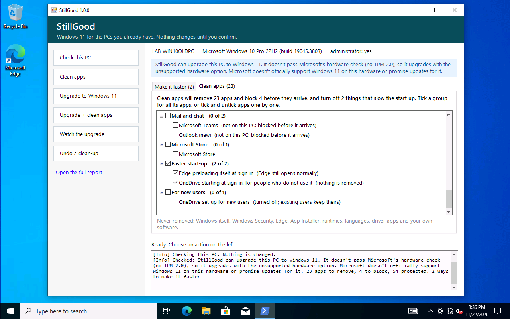

# StillGood

**Windows 11 for the PCs you already have. Your PCs are still good.** Report, clean and upgrade a fleet of Windows PCs, silently and without losing a file. Built by an IT admin for small IT teams.

Windows 10 support has ended. Millions of working PCs fail Windows 11's hardware check. The tools that get around the check work one PC at a time, with someone at the keyboard. The "debloat" scripts are aggressive and undocumented, and on a business PC they break printing, scanners, point-of-sale devices or someone's OneDrive. A team of one to three people looking after 50 to 500 PCs has no SCCM and no time to babysit each machine.

This toolkit is for that team.

## What it does

| Mode | What happens | Changes the PC? |
|---|---|---|
| **Report** | An inventory of the PC, Windows 11 readiness (each check with what it needs, what was found, and whether anything gets around it), what slows the PC down (most important first, with what to do), and an exact preview of what Clean apps would do. HTML for people, JSON for tools. | No |
| **Clean apps** | Removes the apps Windows ships and pushes (Copilot, Xbox, Widgets, promoted third-party apps) for every user and for new users, and blocks them from coming back with feature updates. Turns off silent app installs, and the two start-up items below. | Yes, with undo |
| **Upgrade** | Gets Microsoft's Windows 11 image and checks it against a pinned SHA-256. It runs Setup's compatibility scan first, then upgrades silently in a background task that survives sign-out. After a verified sign-in on the new Windows, it deletes the image. | Yes |
| **Upgrade + clean apps** | Cleans first, upgrades, then cleans again at the first sign-in on Windows 11, for the apps Windows 11 brings. | Yes |
| **Monitor** | Shows the upgrade's stage, measured progress and real activity. | No |
| **Undo** | Puts back every setting a clean-apps run changed and lifts its blocks. The removed apps come back from the Microsoft Store. | Yes |

**Faster start-up.** Clean apps also turns off two things that measurably slow the start of the day, and nothing else (see *What the lab measured*):

- **Edge preloading itself at sign-in.** Edge's own two policies: no startup boost, no background mode. Edge opens as before, a moment slower the first time; it just isn't loaded before anyone asks for it, and doesn't keep running after its last window closes. On a Windows 11 PC where Edge has been used once: 82 MB more memory free and 6 fewer processes after sign-in.
- **OneDrive starting at sign-in, only for people who don't use it**: no files in their OneDrive and not signed in to it. It's marked off the way Task Manager's *Startup apps* does it, so it shows there as disabled. Nothing is uninstalled, and anyone who uses OneDrive is not touched. On Windows 11: boot 10 seconds faster, 81 MB more memory free.

Both are ticked by default, both can be unticked, and Undo puts both back.

**Make it faster.** The check also looks for what really slows an old PC down: a spinning hard drive (an SSD is the biggest single speed-up), too little memory and whether a slot is free, programs that start with Windows, a nearly full disk and what can be freed, a failing disk, two antivirus programs at once, a restart that is waiting or weeks without one, the Power saver plan and a worn battery. Most important first, each with what to do, and what is already good. It only looks: nothing changes.

## What the lab measured

Before anything went into Clean apps, 44 measured runs on Hyper-V VMs sized like an old office PC: 2 processors held to 35% of their speed, 4 GB of memory, a disk held to 1,500 operations a second. Windows 11 26H2, Windows 10 22H2, and Windows 10 on a PC without TPM. Each run started from a settled checkpoint (Windows' one-time after-install work finished), and each baseline was repeated two or three times. Boot time is Windows' own measurement; memory, processes and CPU are read inside Windows and from the host. Noise is about ±10 MB, ±1 process and ±1 second.

**Kept, because it measurably helps and can't break other apps:**

| Change | Windows 11 | Windows 10 |
|---|---|---|
| Clean apps (the defaults) | 82 MB more free, 10 fewer processes, 18% less CPU in the minutes after sign-in | no change at idle |
| OneDrive not starting at sign-in (people who don't use it) | boot 10 s faster, 81 MB more free | boot 3 s faster, 35 MB more free |
| Edge not preloading (on a PC where Edge has been used) | 82 MB more free, 6 fewer processes | no change (Windows 10's Edge didn't preload) |

**Left out on purpose:**

- **Search tweaks** (web results, highlights, Cortana), **hiding the search box**, **turning the search indexer off**: nothing measurable. On 26H2, Start keeps the same search panel either way.
- **SysMain (Superfetch) off**: saved nothing, and Windows 11 booted 3 seconds slower.
- **The telemetry service and its tasks**: 20 MB and 2 seconds on Windows 11, nothing on Windows 10. Too small to justify turning off a service.
- **Background apps off**: 27 MB on Windows 10, nothing on Windows 11.
- **Defender scan limits**: they only matter while a scan runs, and protection stays as it is.
- **The Windows AI and inventory services**: nothing measurable.
- **A "deep" bundle of services from Microsoft's own optimization list**: it looked fastest, but it broke Windows' boot diagnostics and left the notification and clipboard services unable to start.

**For context:** on the same budget, Windows 11 takes 127 seconds to boot against Windows 10's 61, and uses 690 MB more memory. Even with every change above, it still needs 116 seconds. Clean apps claws some of that back. On an old PC, the real speed-up is still an SSD and enough memory, which is why the check points to them first.

A VM can't show everything: a real spinning disk, a weak graphics chip, the power plan, Fast Startup and a PC maker's start-up software all need real hardware.

## The rules

- **Preview first.** Every mode shows exactly what it will change and waits for a confirmation. From a script or an RMM tool, `-Apply -Yes` is the confirmation.
- **Catalog-driven.** Only apps listed in [`catalog/apps.json`](catalog/apps.json) are ever removed. Unknown apps are kept and listed in the report.
- **A protected list enforced in code** ([`modules/Guard.psm1`](modules/Guard.psm1)): runtimes and frameworks, the Windows shell, Start, Search and Settings, Windows Security, codecs, App Installer, languages and speech, driver companion apps, Edge and WebView2, anything Windows marks as a system component or non-removable, and your organization's own software. No catalog or switch can turn it off. The guard is checked when the plan is made, and again right before each removal.
- **Never touches security or services.** The toolkit can write only to a short list of registry settings. Defender, the firewall, Windows Update, UAC, BitLocker and licensing are refused in code, even if the list were widened by mistake. It doesn't stop or disable any service.
- **You choose, app by app.** Every app StillGood can remove sits in a group (AI apps, news and extras, Xbox and games, retired apps, everyday tools, mail and chat, the Store...), each with its own tick: tick a group for all its apps, or untick one app to keep it. The defaults suit an office PC: the everyday tools (Calculator, Photos, Snipping Tool, Paint, Camera, Media Player, To Do, Quick Assist), Outlook, Teams and the Store start unticked. For a kiosk or a till, tick them. The two start-up items have a group of their own.
- **OneDrive safety.** OneDrive is never removed, for anyone. It stops starting at sign-in only for people with no files in it who aren't signed in to it. Turning off its set-up for new users is a choice of its own, unticked by default.
- **Honest progress.** Time left is shown only where it can be measured: the download and the image check. During Setup, the monitor shows Setup's own reported percentage, whether Setup is working, and the last line of its log. There are no invented countdowns.
- **Everything logged, everything undoable, safe to run again.** Each run writes a readable log, a machine log, the plan, the result and an undo file. A second run acts only on what is still there.
- **Any Windows language.** The safety checks, file names and dates behave the same under every language and region setting; they're tested under Turkish, Thai, Saudi and Persian formats. Nothing depends on translated Windows messages, and the upgrade picks the image in each PC's own language.
- **Lab before release.** See *Status* below.

**Good to know.**
- When the last app that uses a shared runtime (the Windows App Runtime, for example) is removed, Windows removes that runtime by itself. StillGood never removes runtimes; they come back automatically with any app that needs them.
- StillGood removes an app's new-user copy first, which takes every user's copy with it, then anything still installed. (On Windows 10 the other order fails at Windows' clean-up step; the lab caught it.)
- The Edge item uses Edge policies, so Edge's settings page says the browser is managed by your organization. On a managed fleet it already is.
- If someone starts using OneDrive later, it won't start by itself at sign-in until it's turned back on: Task Manager, *Startup apps*, OneDrive, *Enable*. Or run Undo.

## What it will not do

- Touch licensing or activation.
- Weaken security or stop Windows Update.
- Turn off services. The popular ones were measured (see above): the gains were within the noise, or came with breakage.
- Pretend Microsoft supports Windows 11 on hardware below its requirements. Microsoft doesn't, and doesn't guarantee updates there. The report says so, and the upgrade refuses such a PC unless the admin passes `-AllowUnsupportedHardware`. The decision stays with the admin.
- Upgrade a PC with less than 4 GB of memory, or a processor without SSE4.2/POPCNT. Windows 11 24H2 and later don't start without them, so no option gets around this.
- Apply "speed hacks": killing services wholesale, turning off the page file, or registry tweaks with no measurable effect.

## Quick start

Requirements: Windows 10 version 2004 or later, or Windows 11, on 64-bit x64; Windows PowerShell 5.1, which is built into Windows.

**On one PC:** download the zip, extract the whole folder, and double-click **`StillGood.cmd`**. Windows asks once for administrator rights, then the StillGood window opens. It checks the PC straight away; nothing changes until you confirm.



The left column lists the actions. In the middle you see the PC and its Windows 11 verdict, then two tabs. *Make it faster* lists what slows this PC down and what to do. *Clean apps* has one list of everything Clean apps can do, under its group, each with its own tick: tick a group for all of it, or untick one app to keep it. The line above the list says exactly what will go. The log at the bottom shows what StillGood is doing. The upgrade is watched in a small window of its own, which you can leave open after closing the main one.

**From a script, a terminal or an RMM tool:**

```powershell
# The text menu
powershell -ExecutionPolicy Bypass -File .\StillGood.ps1

# A read-only report (opens nothing, changes nothing)
.\StillGood.ps1 -Mode Report

# Clean apps: preview, then apply
.\StillGood.ps1 -Mode CleanApps
.\StillGood.ps1 -Mode CleanApps -Apply

# Change the defaults by group or by name (groups: ai, communication, consumer, everyday, gaming, newusers,
# promoted, retired, startup, store, tools; or all). A till: also the everyday tools and mail, but keep Calculator.
.\StillGood.ps1 -Mode CleanApps -Include everyday,communication -Exclude Microsoft.WindowsCalculator -Apply

# Leave OneDrive's start-up alone (the start-up items: Startup.EdgePreload, Startup.OneDriveSignIn)
.\StillGood.ps1 -Mode CleanApps -Exclude Startup.OneDriveSignIn -Apply

# Upgrade: fill in config\upgrade.json first (see below)
.\StillGood.ps1 -Mode Upgrade -Apply
.\StillGood.ps1 -Mode Monitor

# Undo the latest clean-apps run, and reinstall the apps (run as the signed-in user)
.\StillGood.ps1 -Mode Undo -Apply -Reinstall
```

## Using it across a fleet

Run it as SYSTEM from your RMM tool (Action1, NinjaOne, Intune remediation, a GPO startup script), with `-Apply -Yes`:

```powershell
powershell -ExecutionPolicy Bypass -File .\StillGood.ps1 -Mode CleanApps -Apply -Yes
powershell -ExecutionPolicy Bypass -File .\StillGood.ps1 -Mode CleanApps -Include all -Apply -Yes   # a kiosk: everything StillGood knows
```

**Exit codes:** `0` done · `1` failed (see the log) · `2` refused (a blocker or a safety rule) · `3` not confirmed · `10` preview only.

**Logs and reports:** `%ProgramData%\StillGood\runs\<time>-<mode>\` holds `run.log`, `events.jsonl`, `report.html`, `report.json`, `plan.json`, `result.json` and `undo.json`. Undo files are also copied to `%ProgramData%\StillGood\undo\`.

**Your organization's apps:** copy `catalog/organization.example.json` to `catalog/organization.json`. Its `keep` list protects your own software, or anything you never want removed (wildcards allowed). It can only add protection. Its `alsoRemove` list makes extra catalog apps start ticked on every PC.

**The Windows 11 images, one per language:** an in-place upgrade needs an image in the language the PC's Windows was installed in; a Hebrew PC needs the Hebrew image. Copy `config/upgrade.example.json` to `config/upgrade.json` and list an image for each language in your fleet, keyed like `en-US`, `he-IL` or `ar-SA`. `catalog/languages.json` lists all 38 languages Microsoft publishes and the names its download page uses. Each PC picks its own image. A PC whose language has no image is refused before anything changes, with a message naming the exact image to download. Download each image once from Microsoft's Windows 11 page ("Download Windows 11 Disk Image (ISO) for x64 devices"). Put it on a share or web server you control, and paste its SHA-256 from the same Microsoft page ("Verify your download"). Microsoft's own links expire after 24 hours. The pinned SHA-256 guarantees that every PC gets Microsoft's exact image. If a download stalls, the PC waits for the image in `%ProgramData%\StillGood\upgrade\drop\`, where a READ ME says exactly which file to put there.

**The upgrade, step by step:** a local copy of the toolkit and a scheduled task (SYSTEM) take over, so a USB stick can be removed and the user can sign out. The task gets and checks the image, then runs Setup's compatibility scan (`/compat scanonly`). Only if the scan is clean does it run the upgrade (`/auto upgrade /quiet`, keeping files, apps and settings). Setup restarts the PC when it is ready; with `-NoRestart`, you restart it yourself. At the next sign-in, a second task confirms the new build, deletes the image, runs Clean apps again if asked, and removes itself. If Setup rolled back, the second task says so and keeps the image for another try.

**The unsupported-hardware option** (`-AllowUnsupportedHardware`) sets Microsoft's documented `AllowUpgradesWithUnsupportedTPMOrCPU` value and runs Setup with `/product server`, which skips the hardware check. Use it only on PCs you have tested, and knowing that Microsoft does not support the result.

## How it is built

```
StillGood.cmd          double-click: opens the window (asks for administrator rights)
StillGood.ps1          the window, the text menu and the command line
modules/
  Gui.psm1             the window (WinForms)
  GuiCore.psm1         the window's logic: app groups, the trimmed plan, the background runner
  Guard.psm1           the safety rules (protected apps, allowed registry settings)
  System.psm1          every call that changes the PC, behind one swappable table
  Inventory.psm1       read-only: apps, apps for new users, programs, startup items
  Compat.psm1          read-only: Windows 11 readiness
  Speed.psm1           read-only: what slows this PC down
  Catalog.psm1         the catalog, the organization file, the start-up items, and the plan
  Settings.psm1        user profiles, registry changes with undo, "stay removed" markers, who uses OneDrive
  Apps.psm1            Clean apps and Undo
  Report.psm1          the HTML and JSON report
  Upgrade.psm1         image download/copy, SHA-256, drop folder, Setup command line, state
  UpgradeJob.psm1      the background upgrade, the after-upgrade check, the monitor
worker/                the two scheduled-task entry points
catalog/apps.json      every app the toolkit knows, its group, and whether it starts ticked
tests/                 offline tests with a fake PC, and the real-Windows integration test
```

## Tests

```powershell
powershell -NoProfile -ExecutionPolicy Bypass -File .\tests\Run-Tests.ps1
```

55 tests run against a fake PC: fake apps, users, registry, Setup and scheduled tasks. In test mode, any real system call fails loudly, so the tests cannot touch the machine they run on. They cover:

- the safety rules;
- readiness verdicts and processor detection;
- catalog validation;
- the default choices, -Include and -Exclude, the window's ticks, and the organization file;
- removal for every user and new users;
- profile hives (signed-in, signed-out and default);
- the start-up items: who gets the OneDrive mark (never someone with files in OneDrive, someone signed in to it, or new users), and undo;
- re-runs, failures and forged plans;
- undo and reinstall;
- HTML escaping;
- Setup's command line and exit codes;
- SHA-256;
- stalled downloads and the drop folder;
- the full upgrade job, the after-upgrade check, rollback detection;
- the window's logic (groups, unticked groups kept, the background runner and its live log);
- ASCII-only source files.

The window itself is tested by hand on a lab VM: it is opened with `StillGood.cmd` in a signed-in session, a real mouse unticks a group and clicks through the dialogs, and the VM's screen is captured at every step.

## Status

**v1.0.** All three blocks are built and lab-proven, including the full upgrade from Windows 10 with its restarts. One lab, English Windows, no fleet numbers yet: test it on your own PCs first.

**Proven in the lab (2026-11-22):**
- **55 offline tests** against a fake PC (`tests/Run-Tests.ps1`).
- **The full upgrade from Windows 10, on a PC that fails Microsoft's hardware check.** A Windows 10 22H2 Pro VM with UEFI but no TPM, started as SYSTEM the way an RMM tool runs it, with `-AllowUnsupportedHardware`:
  - Clean apps first (the defaults): 23 apps removed, 27 blocked before they arrive, no errors;
  - the image copied and checked against its SHA-256, Setup's compatibility scan, Setup's restarts, and the first sign-in on Windows 11 26H2 (build 26300): 18 minutes in all;
  - afterwards the 8.4 GB image was deleted, StillGood's scheduled tasks were gone and the unsupported-hardware registry value was removed again;
  - none of the 27 apps came back with Windows 11, including Clipchamp and Dev Home, which a fresh 26H2 install adds for new users.
- **The supported upgrade from Windows 10**, on the same Windows 10 22H2 with TPM 2.0 and Secure Boot, without the unsupported option: readiness "Supported", the same Clean apps result, Windows 11 26H2 in 16 minutes, then the image deleted, the tasks gone and none of the 27 apps back.
- **The start-up items on Windows 11 26H2**, Clean apps with the defaults, then a restart. OneDrive no longer started for the lab user, who had never signed in to it. It was still installed, its own start-up entry was untouched, and the only change was the mark Task Manager uses. Edge: no Edge process after sign-in, and it still opened normally.
- **The real-Windows test** (`tests/Integration-Test.ps1`) on a fresh Windows 11 26H2 Pro VM, Hyper-V with a virtual TPM. Clean apps ran as SYSTEM with a user signed in, the way an RMM tool runs it, and passed 15 of 15 checks with everything ticked (`-Include all`):
  - 31 apps removed for every user and new users, and the run log shows no removal outside the plan;
  - all 75 kept and protected apps untouched;
  - the settings applied for the signed-in user, new users and the machine, Edge's policy included;
  - Copilot blocked before it arrives;
  - a second run changes nothing, and Undo restores every setting and lifts the blocks.
- **Today's Windows 11 Setup accepts StillGood's exact command line,** including `/eula accept` and `/product server`. Both compatibility scans returned `0xC1900210` (no issues).

**Found by the lab and fixed:**
- On Windows 10, removing an app for every user while it is still set up for new users fails at Windows' clean-up step (`0x80070002`), so every removal was reported as an error. StillGood now removes the new-user copy first, which takes every user's copy with it: no errors on Windows 10, 31 of 31 on Windows 11.
- The processor check now recognises Xeon E3/E5/E7 (v1 to v6) and the 2013-2016 Atom-class Celeron and Pentium as not on Microsoft's list. They used to show as unknown, which made the report say "probably supported".
- Windows 11 creates an empty OneDrive folder for every user, and writes a OneDrive folder path in the registry before anyone signs in. StillGood first took both as "uses OneDrive" and, safely, did nothing. It now looks for files in the folder and for a signed-in account.

**Known limits:**
1. Not run in the lab: the download, stall and drop-folder paths (the lab VMs have no network), sign-out during Setup, and a forced rollback. They have offline tests only.
2. Not run in the lab: PCs with legacy BIOS only, and processors older than Microsoft's list (a VM shows the host's processor).
3. The blocks for Outlook (new) and Teams across an upgrade when they are ticked (the runs above used the defaults, which keep them), and Copilot's, which needs a networked VM: Copilot is not in the Windows 11 image.
4. A new user signing in after cleaning, Windows Update and a later feature update: the blocks are Windows' own mechanism, but this was not run end to end.
5. Reinstalling removed apps from the Store needs a network.
6. The scripts are not code-signed. Run them with `-ExecutionPolicy Bypass`, as above, or sign them with your own certificate.

## License

[MIT](LICENSE). Anyone may use, change and share StillGood, including at work and in paid services, as long as the license notice stays with it. It comes with no warranty: test it on your own machines first, the way it was tested here.
